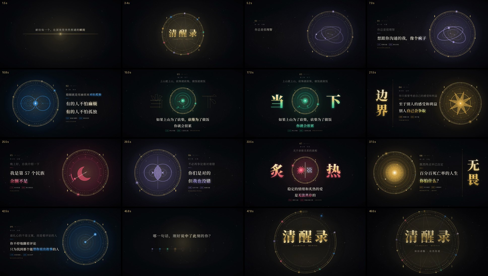
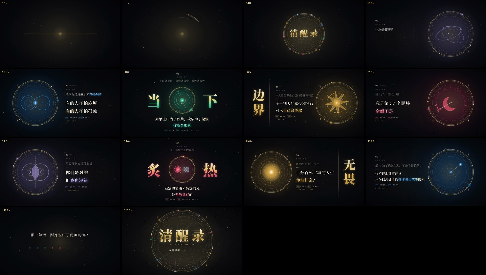
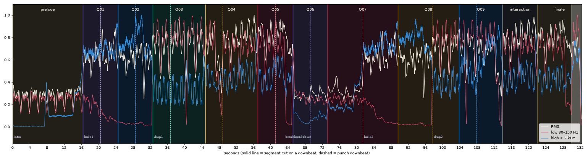

# 清醒录 · 暗黑星盘语录混剪（Remotion）

纯音乐驱动、无旁白的 9 条语录混剪。背景音乐是仓库根目录的 `感知（Amageddon）.MP3`（复制到 `public/music.mp3`）。

同一套画面有两个版本，时间分配都在 `src/config/cuts.ts`：

| 版本 | 合成 | 音乐 | 时长 | 每条语录 |
|---|---|---|---|---|
| **快剪版**（默认） | `ClarityShort` / `ClarityShortPortrait` | 第 8–33 小节（原曲 16.3–67.2 s） | 1527 帧，50.9 s | 2 小节（4 s），最长的两条 3 小节（6 s） |
| 完整版 | `ClarityFilm` / `ClarityFilmPortrait` | 整首（0–132.3 s） | 3969 帧，132.3 s | 4–8 小节（8–16 s） |

都是 1920×1080（竖屏 1080×1920），30 fps，H.264 CRF 18 + AAC 320k。

- 所有动画由 `useCurrentFrame()`、`spring()`、`interpolate()` 和 Remotion 的确定性 `random()` 驱动，没有 CSS `@keyframes` / `transition` / `Math.random()`。
- 所有段落切换和金句时刻都落在拍点上（整小节的落在强拍上）。最大误差：完整版 14.3 ms，快剪版 15.3 ms，都小于半帧（16.7 ms）。
- 星盘光晕、图腾缩放、星点亮度由 `useAudioData` + `visualizeAudio` 实时提取的低频 / 中频能量驱动。

快剪版：



完整版：



---

## 1. 音乐分析

工具：librosa 0.11（脚本在 `tools/analysis/`），图在 `docs/music_overview.png`、`docs/edit_on_music.png`。

| 项目 | 结果 |
|---|---|
| 文件时长 | 164.05 s（ffprobe） |
| **有效时长** | **132.21 s**。音乐在 132.21 s 满音量硬切，后面 31.8 s 是数字静音 |
| BPM | **118.0**。对音乐部分的 260 个拍点做线性拟合，拍长 0.50841 s，最大残差 23 ms |
| 倍速 / 半速复核 | beat_track 用 90 / 120 / 140 作先验都得到 117.5，用 70 得到 78.3（2/3 关系）。自相关峰 58.7（0.83）、117.5（0.79）。按十六分音符折叠：底鼓每拍一下、第 1 拍最重，军鼓 / 拍手在 2、4 拍，踩镲八分音符。结论：4/4 拍，118 BPM |
| 小节 / 乐句 | 一小节 2.034 s，8 小节一个乐句 16.27 s，全曲 65 小节 |
| 强拍 | 4 种相位里低频起音得分最高的相位（8.65，其余 4.14–6.15），整体相位修正 −26.8 ms，每个强拍再吸附到 ±70 ms 内最近的打击乐起音（实际偏移大多 < 10 ms，最大 23 ms）。第 0 小节在 0.093 s |

### 段落结构（bar k = `src/data/music.json` 的 `downbeats[k]`）

| 小节 | 时间 | 段落 | 听感 / 数据 |
|---|---|---|---|
| 0–8 | 0.09–16.36 s | 前奏 | 铺底 + 低频脉冲，约 −19 dB，几乎没有高频；第 3 小节（6.19 s）进踩镲，第 7 小节（14.33 s）上升音效 |
| 8–16 | 16.36–32.64 s | 第一次铺垫（build） | 16.36 s 整体抬升约 7 dB，低音逐渐撤出，高频一路爬升，第 14 小节（28.57 s）最亮 |
| 16–31 | 32.64–63.14 s | **第一次 drop** | 32.64 s 低音砸入；第 23 小节（46.86 s）低音空一小节，第 24 小节（48.90 s）重新进；第 30 小节（61.11 s）全曲最响（−8.7 dB） |
| 31–32 | 63.14–65.17 s | 过门 | 低音撤出 |
| 32–40 | 65.17–81.44 s | breakdown | 全曲最安静（约 −18 dB），第 39 小节（79.38 s）上升音效 |
| 40–48 | 81.44–97.71 s | 第二次铺垫 | 结构同第一次，第 46 小节（93.64 s）高频最密 |
| 48–63 | 97.71–128.21 s | **第二次 drop** | 第 55 小节（111.94 s）低音空一小节，第 56 小节（113.98 s）重新进 |
| 63–65 | 128.21–132.28 s | 收尾 | 第 63 小节低音空拍，第 64 小节是最后一小节，132.21 s 硬切 |

**关于“尾奏”**：这首曲子没有真正的尾奏，结尾还在 drop 里，然后硬切。所以：

- 视频总长对齐到第 65 小节的强拍位置（132.28 s → 3969 帧），整首有效音乐都用上了。
- 互动留白屏放在第 55 小节低音空拍之后（第 56 小节低音重新进入时切入）。
- 收尾短句落在第 63 小节的低音空拍上。
- 用 2.3 s 的音量淡出（129.89 → 132.19 s）代替硬切，画面同步淡到纯黑，最后 3 帧全黑。

---

## 2. 声画对位

`npm run timeline` 会从配置直接打印下面两张表，并检查卡点误差。

### 快剪版（音乐第 8–33 小节，视频时间从 0 算）

| 段落 | 构图 | 起点 | 金句 | 终点 | 音乐位置 |
|---|---|---|---|---|---|
| 序幕 | — | 0.00 s | — | 4.10 s | 第一次铺垫开始（整体抬升 7 dB）。第 8 小节光点、光线、引导句，第 9 小节星盘描边 + 9 枚节点按十六分音符点亮，第 9.5 小节出总标题 |
| 01 失衡 | left-editorial | 4.10 s | 6.13 s | 8.17 s | |
| 02 取舍 | right-editorial | 8.17 s | 10.20 s | 12.23 s | |
| 03 当下 | center-split | 12.23 s | 14.27 s | 18.33 s | 第一次 drop（16.30 s）落在金句第 2 小节：「你就会很累」高亮、「当 · 下」填色、图腾高光都在这一拍 |
| 04 边界 | vertical-accent | 18.33 s | 20.37 s | 22.40 s | |
| 05 自嘲 | left-editorial | 22.40 s | 24.43 s | 26.47 s | |
| 06 立场 | right-editorial | 26.47 s | 28.50 s | 30.53 s | |
| 07 炙热 | center-split | 30.53 s | 32.57 s | 34.60 s | 铺垫在低音空出的那一小节，金句落在低音重新进入的那一拍 |
| 08 无畏 | vertical-accent | 34.60 s | 36.63 s | 38.67 s | |
| 09 共鸣 | left-editorial | 38.67 s | 40.70 s | 44.77 s | |
| 互动留白 | — | 44.77 s | — | 46.80 s | 全曲最响的一小节，9 枚圆点按十六分音符依次点亮 |
| 终幕 | — | 46.80 s | — | 50.90 s | 低音撤出时出标题，breakdown（全曲最安静）开始时 2 s 淡出 |

快剪版里所有固定帧数的文字动画都乘以 `pace = 0.55`（`cuts.ts`），每条铺垫句和金句在 1 小节内完全浮现。

### 完整版

| 段落 | 构图 | 起点（强拍） | 金句重拍 | 终点 | 音乐位置 |
|---|---|---|---|---|---|
| 序幕 | — | 0.00 s | — | 16.37 s | 前奏，16.37 s 第一个重拍切入正片 |
| 01 失衡 | left-editorial | 16.37 s | 20.43 s | 24.50 s | build 前半 |
| 02 取舍 | right-editorial | 24.50 s | 28.57 s | 32.63 s | 金句落在 build 最亮的小节 |
| 03 当下 | center-split | 32.63 s | 36.70 s | 44.83 s | 第一次 drop 砸入时切到第 3 条 |
| 04 边界 | vertical-accent | 44.83 s | 48.90 s | 57.03 s | 金句落在低音空拍后重新进入的那一拍 |
| 05 自嘲 | left-editorial | 57.03 s | 61.10 s | 65.17 s | 金句落在全曲最响的小节 |
| 06 立场 | right-editorial | 65.17 s | 69.23 s | 73.30 s | breakdown（最安静） |
| 07 炙热 | center-split | 73.30 s | 81.43 s | 89.57 s | 安静段做铺垫，第二次 build 抬升的那一拍弹金句 |
| 08 无畏 | vertical-accent | 89.57 s | 97.70 s | 103.80 s | 铺垫压在 build 上，金句落在第二次 drop |
| 09 共鸣 | left-editorial | 103.80 s | 107.87 s | 113.97 s | 金句期间经过第 55 小节的低音空拍 |
| 互动留白 | — | 113.97 s | — | 122.10 s | 第 57 小节起每拍点亮一枚圆点 |
| 终幕 | — | 122.10 s | — | 132.30 s | 第 61 / 62 / 63 小节依次出标题、英文、收尾句 |

序幕内部：第 0 小节第 3 拍点亮光点，第 1 小节拉出水平光线，第 2 小节逐字扫光出引导句，第 4 小节光线收束、星盘描边生长，第 5 小节起 9 枚节点每拍点亮一枚，第 6 小节画星网，第 7 小节出总标题。



---

## 3. 视觉系统

- **一镜到底的星盘**（`components/astrolabe/Rig.tsx`）：全片只有一枚星盘。暖金双环刻度持续顺时针旋转，内刻度环反向旋转，沿弧排列的 `<textPath>` 英文小字，四角菱形星芒。每一段有自己的目标位置，切换时在强拍前 10 帧到后 14 帧之间平滑移过去，同时画面整体轻推一次缩放，一道主题色光晕从左到右横扫。
- **9 个不重复的内环图腾**（`components/emblems/`）：错位双轨道、相切双环与星尘桥、三层渐进同心弧、八角星芒盾与极坐标刻度、残月刻度仪（金句时指针掉进红区）、镜像双圆、烈焰星芒对冷峻方阵、日冕脉冲（每个强拍推出一圈脉冲环）、星尘回声波纹。全部用 `strokeDashoffset` 逐笔生长，金句重拍时点亮核心并亮起星尘点阵。
- **一语两拍**（`scenes/QuoteScene.tsx`）：第 1 拍出序号、眉题和铺垫句；第 2 拍金句 `blur(4px) → 0` 并逐字错峰扫光，关键词换成金属 / 主题色渐变，弹出 1px 细线方框标签和 `0.35em` 字距的拉丁文副标。
- **4 种构图轮换**，相邻两条不重复（`config/timeline.ts` 启动时会自检）。center-split 的拆字和 vertical-accent 的竖排大字在铺垫时只是细描边，金句时填充金属渐变。
- **情绪配色**：青翠绿 `#3CE6B0`、赤焰红 `#FF5B79`、琥珀暖金 `#F0B94D`、冷光银紫 `#B8A8FF`、深海湛蓝 `#3BA4FF`，星盘外环与点睛色统一用暖香槟金 `#E6C97A`。
- **背景**：三层视差星空 + 呼吸微闪、中层邻近星点连线、7 条缓慢形变的星图等高线 + 2 条天球大圆、跟随星盘位置和情绪色的径向氛围光、暗角、`feTurbulence` 胶片噪点（opacity 0.04）。
- **音频响应**（`lib/audio.tsx`）：`useAudioData` 解码音乐，`visualizeAudio`（512 个频点，1024 点 FFT）取 30–150 Hz 和 150–2000 Hz 两段能量，按整首歌的分位数（`tools/analysis/calibrate_reactive.py`）归一化，再做 3 帧平均和 4 帧指数释放。实测：前奏低频约 0.44，breakdown 约 0.40，drop 里 0.75–1.0。用法很克制：星盘光晕强度、低频带来的星盘缩放不超过 1.2%、日冕射线长度、星点亮度最多提高 30%。
- **字体**：中文 Noto Serif SC（思源宋体），回退 Source Han Serif SC / Songti SC / STSong / SimSun；英文 Cormorant Garamond。两个都是放在 `public/fonts/` 里的本地可变字体，渲染时不需要联网。正文行高 1.85。

---

## 4. 项目结构

```
src/
  config/
    format.ts        画幅（FORMAT 一键切换横 / 竖屏）、字号与排版常量
    palette.ts       5 套情绪色 + 暖香槟金
    content.ts       全部文案、配色、构图、图腾 ← 批量替换文案只改这里
    cuts.ts          完整版 / 快剪版的乐段和小节分配 ← 调时长、卡点改这里
    timeline.ts      小节 → 帧，每个版本的段落表，节拍脉冲，配置自检
  data/music.json    BPM、强拍、段落、淡出（tools/analysis/export_timing.py 生成）
  lib/               audio（音频响应）、fonts、layout（4 种构图几何）、rig（星盘插值）、anim、geometry
  components/
    astrolabe/Rig.tsx   全片共用的星盘
    emblems/            9 个内环图腾
    background/         星空、氛围光、等高线、光晕横扫、暗角、噪点
    text/               逐字扫光、序号、眉题、标签、英文副标
  scenes/            Prelude / QuoteScene / Interaction / Finale
  Film.tsx           整片装配 + <Audio> 淡出
  Root.tsx           ClarityShort / ClarityFilm（按 FORMAT）+ 各自的竖屏合成
public/
  music.mp3          背景音乐
  fonts/             本地字体（思源宋体 GB2312 子集、Cormorant Garamond）
tools/
  analysis/          analyze.py → bars.py → export_timing.py → calibrate_reactive.py → plot_edit.py
  timeline.mjs       打印时间线并检查卡点（npm run timeline）
  stills.mjs         按小节号批量渲染静帧（npm run stills -- --short 10 18.5 f:900）
  qc.py              成片自动检查
  make_fonts.py      生成 public/fonts 里的子集字体（补生僻字时用）
  patch_compositor.py  glibc 2.34 机器用，见下文
```

---

## 5. 依赖与运行

需要 Node 18+（推荐 20 或 22），Windows、macOS、Linux 都可以。

| 包 | 用途 |
|---|---|
| `remotion`、`@remotion/cli` | 基础 |
| `@remotion/media-utils` | `useAudioData`、`visualizeAudio`（音频响应） |
| `@remotion/media` | `<Audio>`，带逐帧音量曲线（结尾淡出） |
| `@remotion/fonts` | 加载 `public/fonts/` 里的本地字体 |
| `typescript`、`@types/react`（dev） | 类型检查 |

### 本地渲染

```bash
cd clarity-film
npm install
npm run render               # 快剪版 → out/clarity-short.mp4（1920×1080，50.9 s）
npm run render:full          # 完整版 → out/clarity-film.mp4（1920×1080，132.3 s）
```

其他命令：

```bash
npm run studio               # 浏览器里预览、拖时间轴（4 个合成都在左侧列表里）
npm run render:portrait      # 快剪版竖屏 → out/clarity-short-portrait.mp4
npm run render:full:portrait # 完整版竖屏 → out/clarity-film-portrait.mp4
npm run timeline             # 打印两个版本的时间线并检查卡点
npm run stills -- --short 10 18.5 f:900   # 按小节号 / 帧号导出静帧（不加 --short 是完整版）
npm run typecheck
```

### 网络

- `npm install` 需要访问 npm 源。国内网络慢的话可以用镜像：`npm install --registry=https://registry.npmmirror.com`。
- 第一次渲染时，Remotion 会从 `remotion.media` 下载一个约 100 MB 的 Chrome Headless Shell，之后就缓存在 `node_modules/.remotion/` 里。如果下载失败，可以改用本机已经装好的 Chrome：`npx remotion render src/index.ts ClarityFilm out/clarity-film.mp4 --browser-executable="<chrome 的路径>"`。
- 字体和音乐都在本地，渲染过程中不需要别的网络访问。

### 渲染速度

`remotion.config.ts` 里的并发数是 `min(6, CPU 核数)`。8 核 Linux 机器上快剪版约 1 分 45 秒，完整版约 4 分钟。机器内存小的话，在命令后面加 `--concurrency=2`。

### 字体

`public/fonts/NotoSerifSC-GB2312.woff2`（2.8 MB）覆盖 GB2312 的 6763 个常用汉字、标点，以及 `content.ts` 里现有的所有字。如果新文案用到 GB2312 以外的生僻字，这些字会回退成系统宋体，不会报错。要补字，运行 `pip install fonttools brotli && python tools/make_fonts.py`，它会从 google/fonts 下载原始字体，再按 `content.ts` 重新子集化。字体许可：SIL Open Font License，见 `public/fonts/OFL-*.txt`。

**重新分析音乐**（只有换音乐时才需要，Python 3.10+）：

```bash
pip install -r requirements.txt
python tools/analysis/analyze.py
python tools/analysis/bars.py
python tools/analysis/export_timing.py      # 写 src/data/music.json
python tools/analysis/calibrate_reactive.py # 核对 lib/audio.tsx 里的 dB 区间
python tools/analysis/plot_edit.py
python tools/qc.py --cut short               # 渲染之后（完整版不加 --cut）
```

**glibc 2.34 的机器**：Remotion 的 compositor 需要 glibc 2.35。先运行 `python3 tools/patch_compositor.py`，它会把 compositor 复制到 `bin/compositor/` 并改掉唯一的 `hypot@GLIBC_2.35` 依赖，`remotion.config.ts` 检测到这份副本才会使用它。

---

## 6. 常见修改

- **替换文案**：改 `src/config/content.ts` 的 `QUOTES`。每条有 `setup`（铺垫）、`punch`（金句，`\n` 换行）、`highlight`（高亮词，出现在铺垫句或金句里都可以）、`keyword`、`english`、`tags`、`mood`、`layout`、`emblem`。字号会按最长一行自动缩小。生僻字见第 5 节「字体」。
- **调整时长 / 卡点**：改 `src/config/cuts.ts`。每个版本有 `startBar`（音乐从第几小节开始）、`opening`、`quotes`（每条 `{ start, punch, accent?, end }`，小节号，可以用 .25 / .5 / .75 表示拍）、`interaction`、`finale`，相邻两段首尾要相接。`pace` 控制文字动画快慢。`npm run timeline` 会报出不连续、金句不在段内或者相邻构图重复的问题。
- **再做一个版本**（比如 30 秒）：在 `cuts.ts` 里照着 `SHORT` 加一个，在 `timeline.ts` 的 `TIMELINES` 和 `Root.tsx` 里各注册一下。
- **切竖屏**：`src/config/format.ts` 里 `FORMAT = "portrait"`，或者直接渲染 `ClarityShortPortrait` / `ClarityFilmPortrait`。竖屏样张见 `docs/portrait_sheet.jpg`。
- **换音乐**：替换 `public/music.mp3`，跑一遍第 5 节的分析脚本，再按新的段落表重新分配 `cuts.ts`。

---

## 7. 质量检查（`python tools/qc.py`，两个版本都全部通过）

快剪版（`python tools/qc.py --cut short`）：

```
PASS resolution — 1920x1080
PASS frame rate — 30/1
PASS video frames — 1527 (expected 1527)
PASS length — video 50.901 s, timeline 50.900 s
PASS audio stream — 48000 Hz, 2 ch
PASS audio matches source before the fade — correlation 0.9951 at offset 0.0 ms (source from 16.333 s)
PASS audio level unchanged before the fade — rendered/source RMS 0.997
PASS music fades out over the last 2.0 s — -11.3 dB before fade, -25.0 dB mid-fade, -51.5 dB in the last 0.19 s
PASS starts from black — frame 0 mean RGB 0.00
PASS ends on black — last frame mean RGB 0.00
PASS no black frames between intro and fade — 0 near-black frames in the body
PASS no sudden brightness jumps — max frame-to-frame luma change 3.7 (0-255)
```

完整版（`python tools/qc.py`）：

```
PASS resolution — 1920x1080
PASS frame rate — 30/1
PASS video frames — 3969 (expected 3969)
PASS length — video 132.309 s, timeline 132.300 s
PASS audio stream — 48000 Hz, 2 ch
PASS audio matches source before the fade — correlation 0.9999 at offset 0.0 ms (source from 0.000 s)
PASS audio level unchanged before the fade — rendered/source RMS 0.997
PASS music fades out over the last 2.3 s — -10.9 dB before fade, -18.4 dB mid-fade, -60.1 dB in the last 0.23 s
PASS starts from black — frame 0 mean RGB 0.00
PASS ends on black — last frame mean RGB 0.00
PASS no black frames between intro and fade — 0 near-black frames in the body
PASS no sudden brightness jumps — max frame-to-frame luma change 4.1 (0-255)
```

`npm run timeline`：卡点最大偏差完整版 14.3 ms、快剪版 15.3 ms，都小于半帧。
